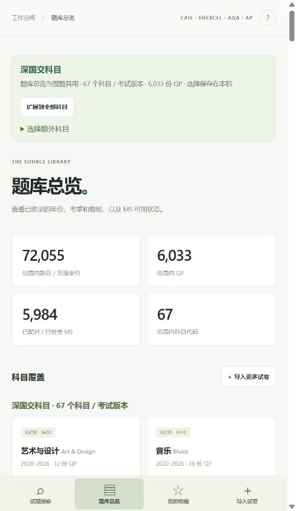

# PaperTrace

拍照或粘贴题干，找到原卷和评分标准。

**[在线使用](https://ash19900601.github.io/PaperTrace/)** · [English](README.en.md)

PaperTrace 是面向国际课程学习者的搜题工具，支持 CAIE、Pearson Edexcel、AQA 和 AP。输入一道题的文字、关键词或试卷编号，即可查找来源，查看年份、考季、卷别、题号与原卷页码，并打开对应的 Mark Scheme。

## 功能

- **文字搜题**：支持英文原句、关键词、常见中文学科术语，以及中文和日语文本片段。
- **拍照搜题**：上传、拖入或粘贴截图，旋转和框选题干后识别英文文字，再直接匹配试题。
- **清晰阅读**：识别结果和题干按段落展示，支持修改识别文字、展开原始文本。
- **来源定位**：打开 QP 原卷和 MS 评分标准，复制来源编号，收藏题目。
- **范围筛选**：按科目、资格类别、年份、考季和卷别筛选，按相关度或年份排序。
- **本机题库**：批量导入 QP/MS PDF，配对评分标准，导入和导出索引 JSON。



## 题库与默认范围

题库覆盖 IGCSE、GCSE、AS/A Level 和 AP，收录年份为 2018–2026。

| 范围 | 科目 / 考试版本 | QP 试卷 | 可搜索记录 |
| --- | ---: | ---: | ---: |
| 深国交默认范围 | 67 | 6,033 | 72,055 |
| 全部题库 | 72 | 6,719 | 82,310 |

记录包含 59,892 条题号索引和 22,418 条页面索引。AP 收录公开 FRQ。各科目的年份、试卷和评分标准可在「题库总览」查看，完整目录见 [manifest.json](dist/data/manifest.json)。

题库总览和搜题默认使用深国交科目范围，包含 9608 计算机科学旧大纲。页面上方可以勾选额外科目、扩展到全部科目，或恢复默认范围。选择保存在当前浏览器，两个页面同步使用。

## 开始搜题

1. 打开 [PaperTrace](https://ash19900601.github.io/PaperTrace/)。
2. 在「文字搜题」中粘贴题干，或切换到「拍照 / 截图」上传图片。
3. 点击「查找试题」，结合科目和年份筛选候选结果。
4. 打开「题干预览」「原卷」或「查看 MS」，继续阅读与练习。

可以直接试用这些查询：

```text
diffraction grating
9702_s24_qp_22 Q2
AP-PSY_s24_qp_1-p3
```

图片识别使用英文模型。公式、上下标和图表可以在识别后修改文字，或结合原卷阅读。搜索原句时，优先选择包含具体情境或专有词的一句话。

## 导入自己的试卷

打开「导入试卷」，选择 QP 和对应的 MS 文件。PDF 导入使用 Cambridge 文件名：

```text
9702_s24_qp_22.pdf
9702_s24_ms_22.pdf
```

每个文件支持最大 30 MB。导入完成后即可搜索；其他科目可以在「选择额外科目」中加入范围。扫描版试卷可通过「拍照 / 截图」识别题干。

收藏、导入的 PDF 和索引保存在当前浏览器。迁移到其他设备时，导出索引 JSON，并在新设备导入 JSON 和对应 PDF。清除网站数据会移除本机保存的内容。

## 本机运行

安装 Python 3，获取项目：

```sh
git clone https://github.com/ASH19900601/PaperTrace.git
cd PaperTrace
```

Windows：

```powershell
py -3 serve.py
```

也可以双击 `start_windows.bat`。

macOS / Linux：

```sh
python3 serve.py
```

访问 **http://localhost:8000/**。保持终端运行，按 `Ctrl+C` 停止。更换端口可以添加 `--port 8001`。

前端、搜索索引、OCR 引擎和英文模型均包含在 `dist/` 中。Python 标准库提供本机 HTTP 服务，浏览器执行搜索、OCR 和 PDF 导入。打开远程原卷和评分标准时需要联网。

## 部署

本仓库通过 [GitHub Actions 工作流](.github/workflows/pages.yml) 将 `dist/` 发布到 GitHub Pages。推送到 `codex/publish` 分支会自动更新网站，也可以在 Actions 页面手动运行 **Deploy PaperTrace to GitHub Pages**。

部署自己的仓库时，在 **Settings → Pages → Source** 选择 **GitHub Actions**，并让工作流中的分支名与默认分支保持一致。

其他静态托管服务可直接将 `dist/` 作为站点目录。运行资源使用相对路径，支持仓库子路径部署。远程站点使用 HTTPS。

## 开发与维护

| 路径 | 用途 |
| --- | --- |
| `dist/app.mjs` | 界面、OCR、收藏和本机导入 |
| `dist/search.mjs` | 文本检索和排序 |
| `dist/index-worker.mjs` | 后台搜索线程 |
| `dist/subject-scope.mjs` | 深国交默认科目与扩展范围 |
| `dist/data/` | 题库清单和各科目索引 |
| `dist/vendor/` | OCR、PDF 引擎、模型和字体 |
| `scripts/` | 题库采集、索引生成和审计工具 |
| `tests/` | 搜索、导入、题干提取和题库测试 |

使用 Node.js 20+ 运行前端测试：

```sh
npm test
```

使用 Python 3.12 维护题库或运行提取测试：

```sh
python -m pip install -r requirements.txt
python manage.py test-extraction
python manage.py test-corpus
```

增量更新指定科目：

```sh
python manage.py rebuild --discover --subjects 9701 9702 --years 2024 2025 2026 --workers 8
```

维护工具会备份当前题库，下载公开试卷并合并索引。新增深国交科目时，在 `dist/subject-scope.mjs` 中更新默认清单。

## 组件与资料来源

浏览器使用 Tesseract.js、Tesseract.js Core 和 PDF.js；题库维护使用 PyMuPDF。试卷来源链接保存在题库清单中，包含 PapaCambridge、Pearson Edexcel、AQA 和 College Board 的公开资源。

组件许可证和试卷资料署名见 [第三方说明](docs/THIRD_PARTY_NOTICES.md)。
