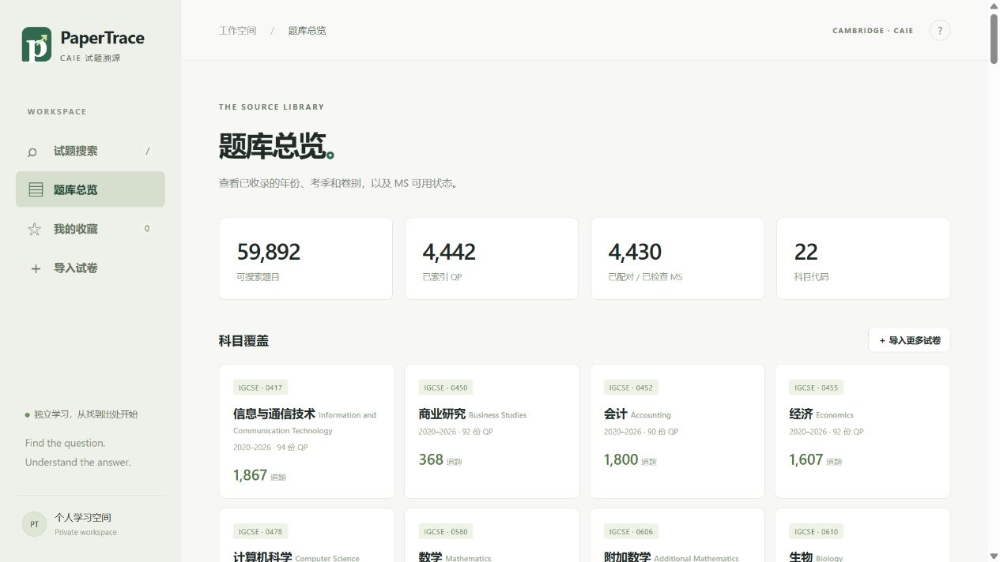

# PaperTrace 实测、修复与题库扩展记录

日期：2026-10-24（Asia/Shanghai）。工作基线为原始 `PaperTrace_Portable_Source_and_Handover.zip`，本次直接修改解压后的源码和题库；原 ZIP、`PACKAGE_INFO.json`、`FILE_MANIFEST.json`、`SHA256SUMS` 仍是 10 月 22 日交付快照的历史记录。

## 阅读与检查范围

已阅读中英文 README、工程交接、原始 README、打包验证、第三方声明、原托管配置及包版本记录，并检查前端业务模块、Worker、PDF/OCR 接口、样式、服务器、维护入口、建库与发布脚本、已有测试。第三方压缩引擎按接口、版本和实际加载行为验证，没有把许可证或打包校验当作功能测试。

程序是静态浏览器应用：PDF 文字索引 → Web Worker BM25 排序；照片 → 本机英文 Tesseract OCR → 同一文字检索。它没有图形相似度或数学公式语义检索。Python 服务器不参与搜索计算。

## 原题库的独立审计

基线：8 科、2020–2026、1,722 份 QP、22,612 条题目记录、1,719 份配对 MS。原包 SHA-256 检查通过；原有 8 项 Node 测试和 6 项 Python 提取测试通过。

从原始 PDF 独立读取 16 道题，每科 2 道，查询、预期来源、题号和原卷起始页保存在 `tests/search-audit.test.mjs`。这是一组分层选样，不是随机总体准确率调查。

- 原始来源 Top-1：15/16；Top-5：16/16；题号和原卷起始页：16/16。
- `0580_s24_qp_22 Q2` 的园丁收费题排第二。另行下载核对 `0580_s24_qp_12` 第 3 页，第一条是该卷 Q7 的重复题干。因此能找到可用来源，但不能凭这段文字唯一确认是哪份卷。
- 原库 276 份理化 MCQ 试卷逐卷统计，均有 40 道记录。该检查验证数量，不等于逐题全文、图形或答案审核。
- 原库 MS 页码已定位 22,488/22,612 条；未定位记录仍需在整份 MS 中找题号。MS 页码的真实 PDF 回归另见提取测试。

## 浏览器端到端检查

通过本机 HTTP 服务实际操作界面，检查文字搜索、试卷页眉与带空格题号、题干预览、QP/MS 页码链接、示例 QP+MS 导入。首次导入示例完成 2/2 个文件，保存 7 条索引。修复后按 `9702/22/M/J/24 Question: 2` 检索只返回对应 Q2，QP p.6–8，MS p.7。

实际截图 OCR（未手工修改识别文字）：

| 截图 | 预期来源 | 初始题库结果 |
| --- | --- | --- |
| 跳伞者物理题，含图表噪声 | 9702_s24_qp_22 Q2，QP p.6、MS p.7 | Top-1 正确 |
| 氧化铜与氨反应，含化学式和百分比 | 0620_s24_qp_21 Q10，QP p.4、MS p.2 | Top-1 正确 |
| 旧版黄铜滴定实验，部分边缘文字被裁切 | 9701_m20_qp_52 Q1，QP p.2、MS p.5 | Top-1 正确 |
| 短积分题，主要信息在公式中 | 9709_m24_qp_12 Q1，QP p.2 | 未进入 Top-5 |

短积分 OCR 得到 `1 Find the exact value of | 2 dr. [3] / 3x`，公式信息已丢失；基线文字检索中的正确来源排第 125。不能把原句测试通过率宣传成拍照识别准确率。页面现在对有效文字不足的 OCR 明确提示无法可靠定位，并建议补充题干或编号。手机实体摄像头、模糊手写和纯图形题未完成实机验证。

## 修复的问题

1. **来源编号解析**：支持 `Q 2`、`Question: 2`、中文题号、MS 文件名及三考季 PDF 页眉；整卷按数字题号排序；含页眉的 OCR 仍按正文定位题目。
2. **前端状态**：清空查询不会再被旧异步响应填回；单科分片加载失败会明确列出缺失科目，并允许搜索其余科目；资格类别来自实际科目元数据。
3. **本机导入**：JSON 来源身份、页界、重复 ID 校验；重导 QP 保留已知 MS 页码；导入新的 MS 清除旧页码；并发导入互斥；未验证链接不冒充已检查。
4. **多列 MS**：保留 PDF 文本单元，逐列识别答案表。此问题以构造的多列布局回归验证。六份真实 PDF 样本的提取也通过，但现有真实 MCQ MS 本来就是单列，不能将其描述成修复前漏列的证据。
5. **增量建库**：默认保留未选中的科目和年份，跳过已有卷；下载失败、空提取和题数异常减少不覆盖旧记录；MS 临时失败不删除旧配对；只有显式 `--replace` 才整库替换。
6. **新科目误分题**：生物实验题表格中的 3、4 被当成主问题，导致真实 Q3 被吞并。建库和浏览器本机导入两条路径均已复现并修复，用首个题号左边距约束后续题号，核对 `9700_s24_qp_51` 真 Q3 从 p.14 开始，`9700_s24_qp_53` 只有 Q1–2。
7. **维护与刷新**：UTF-8 写题库；MS 必须能实际打开；目录发现保存可续跑的任务清单；本机服务器使用 `Cache-Control: no-cache` 让更新后的脚本、Worker 和题库在刷新时重新验证。实测原服务器普通刷新会继续使用旧搜索模块。
8. **PDF 并发处理**：联网时下载保持并行，PDF 解析和 OCR 使用进程内锁串行处理；离线重提取使用独立进程并行，避免多个线程同时访问 PyMuPDF。PyMuPDF 官方明确说明多线程调用可能导致错误或崩溃，因此不能把原有下载线程直接用于并发解析。[官方说明](https://pymupdf.readthedocs.io/en/latest/recipes-multiprocessing.html)
9. **ICT 真实文件名**：公开目录的实操 QP 使用 `02/03`，MS 使用 `2/3`；保留 QP 前导零并正确配对答案卷，搜索和本机导入使用相同身份规则。浏览器实测 `0417_w20_qp_02` 的 35 条索引与 `ms_2` 成功配对。
10. **原卷撤题造成后续漏题**：`0455_w21_qp_11/12/13` 正式删除 Q22，旧连续题号规则只提取到 Q21。现在识别原卷撤题声明，保留 Q23–Q30；每份可用题目是 29 道，不能照封面旧文字伪造 30 道。真实 PDF.js 浏览器导入和 Python 提取均已回归。
11. **中文路径下的维护端 OCR**：本机 Tesseract 无法从中文目录加载模型。维护入口在 Windows 中文项目路径下改用用户临时目录的模型副本，实测扫描卷 `0478_s20_qp_23` 修正模型路径及 OCR 页间题号轻微偏移后，恢复全部 7 条，起始页为 3、8、9、10、11、12、12。扫描 OCR 的文字仍可能存在识别错误。
12. **经济材料题首题无独立编号**：`0455_w21_qp_22` 只用明确的材料题说明引入 Q1，原来退化为 4 条按页记录。两条提取路径现在识别该说明，得到 Q1–Q5，起始页 2、4、4、4、5。

13. **真实数值和小幅排版偏移**：原建库规则删除了独立的数字文本块，导致公式系数丢失；现保留这些数字。`0606_m20_qp_12 Q2` 在首次扩库审计中排第 6，修复后重新测量排名。会计 `0452_w25_qp_12` 的 Q29 比首题右移约 4.4 点，阈值由 4 调到 5，恢复全部 35 道；生物表格误分题回归仍通过。本轮全部缓存题卷重新提取，未重新下载旧库的每一份原始 PDF。

14. **代码行号、电子表格行号冒充题号**：结合字体差异与连续、紧凑的行号布局识别表格，并排除 `01` 之类代码行号。正常主问题允许更换字体，不能简单要求整卷字体相同。新增 ICT/旧大纲计算机试卷，以及原库中的 `0478_m22_qp_22`、`0620_s21_qp_61`、`0620_s26_qp_63` 均确认受影响。原库 3 份卷中的 16 个伪题号被明确更正，恢复实际主问题；精确 ID 与原卷页码见 `reports/original-record-corrections.json`。原始快照完整保留，审计只允许这份清单中经核实的删除，其余原记录丢失仍报错。

## 扩展与复现

扩展从公开考季目录读取真实文件名，只有已下载、可解析且有可搜索文字的 QP 才计入题库。网络错误、未公开文件和题号待核对记录必须与成功收录分开统计。目录中的文件总数不代表实际完成索引数。

最终题库：**22 个科目代码、4,442 份 QP、59,892 条记录，已有年份 2018–2026**。相对基线净增 2,720 份试卷和 37,280 条记录。新增范围包括生物、附加/进阶数学、经济、商业、会计、ICT、综合科学、协调科学及旧大纲计算机；科目代码数量不等同于学科门类数量。

本次目录共发现 2,748 份待扩展 QP，实际新增 2,720 份；其余 **28 份未收录**：24 份返回非 PDF 内容，4 份仍有网络错误。**12 份已收录 QP 尚未配对 MS**。文件名和原因见 [缺口清单](reports/coverage-gaps-2026-10-24.json)，可继续按 [发现任务列表](reports/expansion-jobs-2018-2026.json) 增量补齐。

- 最终全库身份、重复 ID、题号连续性、页界和清单计数检查：**0 项错误**。实际打开核对 2,726 份缓存 QP、2,714 份缓存 MS；621 份 MCQ 的数量与原 PDF 封面及撤题声明相符。详细结果见 [机器审计](CORPUS_AUDIT_2026-10-24.json)。
- 原始 22,612 个记录 ID 中保留 22,596 个，另 16 个经原卷核实属于伪题号，已按明确清单更正；补回对应真实题目。**意外丢失为 0**，原始数据完整保存在 `.backups/corpus_20261024T085153_745413Z/`。
- 已检查 MS 4,430 份；58,922 条已定位答案页，970 条未定位具体 MS 页。当前按页兜底记录为 0，但这不代表全文、图形或每个答案页均经过人工逐题审核。
- 自动测试：**37/37 Node、15/15 Python PDF 提取、12/12 Python 建库测试通过**；覆盖 20 份真实 PDF 样本。实测环境为 Node 22.16、Python 3.13.5、PyMuPDF 1.26.6。
- 扩库后独立原卷样本：原有 16 道的原始来源 Top-1 15/16、Top-5 16/16；扩展的 30 道 Top-1 25/30、Top-5 30/30。合计 **Top-1 40/46、Top-5 46/46，题号及 QP 起始页 46/46**，覆盖全部 22 个科目代码。完整逐题排名见 [搜索审计](reports/search-audit-2026-10-24.json)。这些是分层选样，不是总体准确率。
- 数学 `0606_m20_qp_12 Q2` 修复数字丢失后从第 6 升至第 3，仍不能把公式检索当作已解决的问题。短积分截图在最终题库排第 276，界面明确显示无法可靠定位。相同或相近题干也可能对应多份卷。
- 最终浏览器重新验证了新增生物原句、ICT 答案卷编号和截图 OCR。生物样本首条为 `9700_s24_qp_11 Q1`，QP/MS 均 p.2；ICT `ms_2 Q1` 唯一定位 `qp_02 Q1`；最终题库重新运行四张实际截图：物理和两张化学截图首位来源正确，短积分仍失败并显示提示。一次生物查询显示 556 ms、编号查询 17 ms，仅作为本机操作记录，不是性能保证。

| 科目代码 | 科目 | 资格 | 已有年份范围 | QP | 题目记录 |
| --- | --- | --- | --- | ---: | ---: |
| 0417 | 信息与通信技术 | IGCSE | 2020–2026 | 94 | 1,867 |
| 0450 | 商业研究 | IGCSE | 2020–2026 | 92 | 368 |
| 0452 | 会计 | IGCSE | 2020–2026 | 90 | 1,800 |
| 0455 | 经济 | IGCSE | 2020–2026 | 92 | 1,607 |
| 0478 | 计算机科学 | IGCSE | 2018–2026 | 114 | 959 |
| 0580 | 数学 | IGCSE | 2018–2026 | 239 | 4,388 |
| 0606 | 附加数学 | IGCSE | 2020–2026 | 92 | 1,035 |
| 0610 | 生物 | IGCSE | 2020–2026 | 255 | 4,222 |
| 0620 | 化学 | IGCSE | 2018–2026 | 356 | 6,043 |
| 0625 | 物理 | IGCSE | 2018–2026 | 359 | 6,565 |
| 0653 | 综合科学 | IGCSE | 2020–2026 | 258 | 4,682 |
| 0654 | 协调科学（双证） | IGCSE | 2020–2026 | 244 | 4,826 |
| 9231 | 进阶数学 | AS & A Level | 2020–2026 | 168 | 1,178 |
| 9608 | 计算机科学（旧大纲） | AS & A Level | 2018–2019 | 47 | 283 |
| 9609 | 商业 | AS & A Level | 2020–2026 | 166 | 727 |
| 9618 | 计算机科学 | AS & A Level | 2021–2026 | 118 | 886 |
| 9700 | 生物 | AS & A Level | 2020–2026 | 269 | 2,945 |
| 9701 | 化学 | AS & A Level | 2018–2026 | 334 | 3,586 |
| 9702 | 物理 | AS & A Level | 2018–2026 | 333 | 3,773 |
| 9706 | 会计 | AS & A Level | 2020–2026 | 154 | 1,671 |
| 9708 | 经济 | AS & A Level | 2020–2026 | 196 | 3,451 |
| 9709 | 数学 | AS & A Level | 2018–2026 | 372 | 3,030 |

年份列只表示当前已有的首末年份，不保证每年、每考季、每卷全部齐全。全量原 PDF 缓存位于 `.cache/pdfs/`，不是部署内容；浏览器只需 `dist/`。本次所有修改位于解压后的 `PaperTrace/`，没有生成新的安装包、发布 ZIP，也没有推送 GitHub。

最终浏览器总览（未加载本机测试导入，控制台无错误）：



常用验证：

```powershell
python manage.py test-search
python manage.py test-import
python manage.py test-extraction
python manage.py test-corpus
python scripts/audit_corpus.py --baseline .backups/corpus_20261024T085153_745413Z/data --targets docs/reports/expansion-jobs-2018-2026.json --corrections docs/reports/original-record-corrections.json
```

按目录增量扩充（不打包）：

```powershell
python manage.py rebuild --discover --subjects 0610 9700 --years 2024 2025 2026 --workers 12
```

保存的任务列表位于 `.cache/discovery/`；使用 `--jobs-file <列表路径>` 加相同科目/年份范围可续跑。下载缓存与备份位于 `.cache/`、`.backups/`，不应作为静态网站资源部署。

本机 Python 的网络链路出现过 SSL EOF/握手超时。失败目录用系统 curl 重取成功，因此维护脚本增加显式 `--transport curl` 选项（需要 PATH 中已有 curl）；默认仍使用 Python 标准库，不修改系统代理或关闭证书验证。

审计确认提取规则变更后，允许已有试卷题数减少的离线校正必须显式使用 `--offline --refresh-existing --accept-corrections`；默认仍保留减少前的题数。先核对范围并保留 `manage.py` 自动生成的备份。

`python serve.py --check` 仍比对原始交付快照，修改后出现旧校验和不一致是预期结果；当前功能状态以以上测试、最新 manifest 和本记录为准。本次没有运行发布构建、生成新 ZIP 或推送 GitHub。
